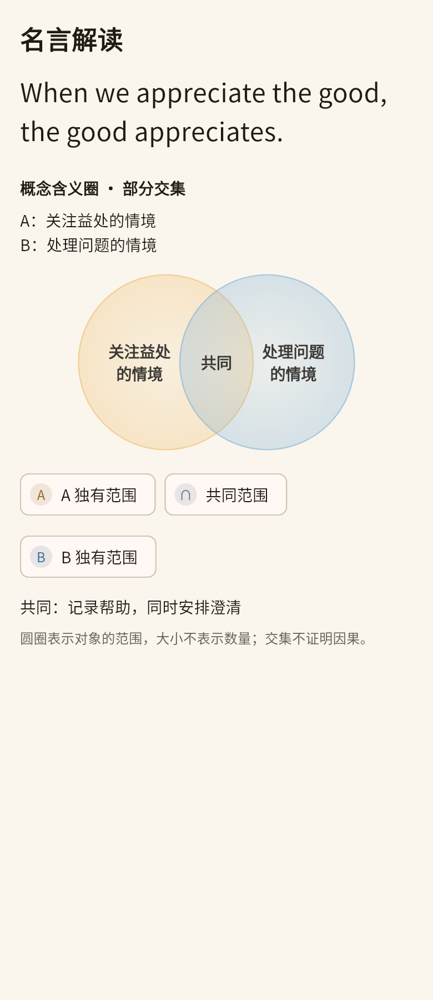

# 原型差距与认识分析改进（2026-11-01）

本次以用户提供的十页手机原型展板、实际截图和《认识论融合优化方案》为依据，检查 `1baa2de` 上的实际入口。此前存在入口但主要展示文字，不能据此视为已经实现了原型的全部视觉与分析要求。

## 本次对应关系

| 原型 / 问题 | 实际修改 | 使用与限制 |
| --- | --- | --- |
| 阅读层的直观场景没有画面 | `QuoteIntuitiveGallery` 主动读取当前名言的已有配画，支持查看大图、首次生成、重新配画；生成后刷新逐句对应说明 | 不依赖首页是否传入路径。无缓存时明确显示生成入口；仅点击才使用用户已配置的图片接口，失败保留原句和例子。 |
| 概念含义圈缺失或只画 A/B | 共用概念含义圈组件，圆内显示实际概念，展示成员判准、论域、交集/独有范围与局限 | 支持外延重合、包含的两个方向、部分交集、互斥、互斥且穷尽上位范围、同属上位范围但不穷尽。无法支持集合关系时继续使用对照。 |
| 新名言也只有概念标签 | 同次名言生成返回 `cognition.abstractions` 和可选 `concept_scopes`，随原附属数据保存并在阅读层呈现 | 无需额外请求；旧名言缺字段继续正常阅读，可主动展开新分析。 |
| 抽象概念解释过浅 | 展开概念定义、具体材料、共同规定、抽象省略的细节、反例/非成员 | 不用关键词列表替代从具体到抽象的过程；概念树、阅读层、分析面板和电影共用展示。 |
| 日记只有列表和隐蔽的长按操作 | 正文下显示事实/感受/解释/判断/根据五个入口与时间、空间、因果、认识根据、动机五视角 | 先选择文字块，也保留长按精确选句；仅发送所选文字，分析仍是独立、可撤销注释。点击视角后优先显示该视角内容。 |
| 历史星图缩小后拥挤 | 聚焦所选概念及最多六个相邻节点，提高初始缩放；全部概念仍可搜索和分组选择 | 连线表示记录中的概念共现，不是概念外延的交集，也不证明因果。人物视图复用已记录头像。 |
| 比较图藏在长文末尾 | 图形/关系先于详细分析显示，统一暖纸色的阅读与比较控件 | 由验证后的关系类型选择图形；包含共同上位范围的图必须提供论域。 |
| 电影分析只扩写简介且弹窗窄 | 改为大面积阅读面板；逐情节展示抽象规定、判断、其他解释和检验办法 | 简介摘录仍须逐字对应，不冒充已核对的影片镜头；重新分析才升级旧缓存。 |
| AI 反复泛泛回答 | 文字与聊天请求共用 `SchopenhauerGuidance`，覆盖认识分析、名言生成/比较/配画脚本、电影和向己分析角色 | 保留各模块输出协议；不会对翻译、语音识别等无关请求追加哲学任务。 |
| 旧分析遮蔽新要求 | 更新认识/比较提示词缓存版本；显式“按新方法重新分析”创建新注释 | 旧的已采纳注释、分类修改和修订保留；失败不替换旧结果。 |

## 哲学依据与产品边界

依据 [《作为意志和表象的世界》第一卷第一篇，§9、§14（Haldane / Kemp 公开文本）](https://www.gutenberg.org/files/38427/38427-h/38427-h.html)。

- §9：概念是不同于直观表象的一类认识；抽象保留共同规定并省略个别细节。概念圈表达外延关系，不等于主题相似、情绪强度或因果关系。
- concreta / abstracta 的较直接/间接依赖直观，与一般/个别的层级是不同区分；不把共相与殊相简化成“多与少”，也不混同柏拉图理念。
- §14：判断力使知性中的具体认识与理性中的概念发生准确联系，依当前目的辨识局部相同中的差异、局部差异中的相同。需要说明哪项差异会改变本次结论。
- 判断的认识根据与事件的生成根据不同；界面的五个视角是产品操作化，不能说叔本华有“五种根据律”。
- 图画和模拟情境帮助理解，不能穷尽概念或证明判断。模型构造的集合示意明确标记，不冒充原句已证明的事实。

## 新结果的质量门槛

新的认识分析缺少具体材料、保留的规定、省略的细节、反例、同异或根据时不保存为成功结果。新的电影分析须有概念抽象过程；有简介时须至少有一条逐字对应的情节材料。旧缓存读取不套用新生成校验，避免旧记录打不开。

这些是结构与证据对应检查，不能保证模型在哲学解释和实际成员关系上必然正确；仍需要在用户实际配置的供应商上检验内容质量。

## 验收操作

1. 设置中开启“叔本华认知风格”，从首页进入阅读全文。
2. 直观页检查已有配画；无图时点击生成，失败时原句、解读和例子应可继续阅读。
3. 查看新生成名言的概念展开；旧记录主动点击展开/重新分析。只有合适的外延关系才出现概念圈。
4. 比较两条名言，先看关系图，再切换共同点、差异和适用条件。用包含、重合及共同上位范围分别检查图形。
5. 打开一篇日记，在正文下选择视角和文字，检查原文、附件、时间戳不被分析改写；采纳、修改和删除仅影响注释。
6. 打开电影旧分析仍能阅读，点击“按新方法重新分析并覆盖”后检查情节到概念的展开。
7. 关闭认知风格或关系图，确认既有阅读仍可使用；320px / 2倍文字下可滚动和操作。

## 自动化与预览

新增 `test/cognitive_prototype_test.dart` 检查外延类型、伪造摘录拒绝、示意身份、附属数据往返、概念图交互/文字放大、日记五视角和配画失败。`cognitive_core_test.dart` 增加重新分析保留已采纳修订、浅层输出不替换旧结果的测试。

本地验证：121项相关回归通过；2项构建禁用开关测试通过；认识模块、共用模型与相关服务/组件的严格静态检查无问题。日记编辑器全文件检查无编译错误，但其既有25项警告/提示仍保留。测试使用Flutter 3.35.7；CI使用仓库既定Flutter版本。

以下是实际 Flutter 组件渲染的测试场景，属于界面验证，不是供应商实测输出或真机截图：

